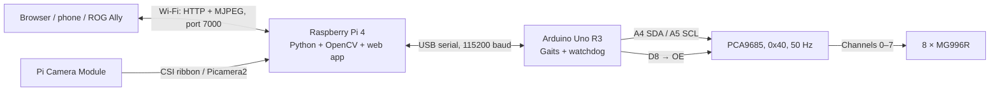
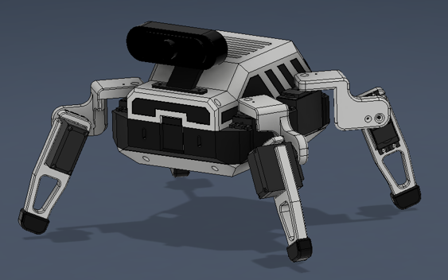
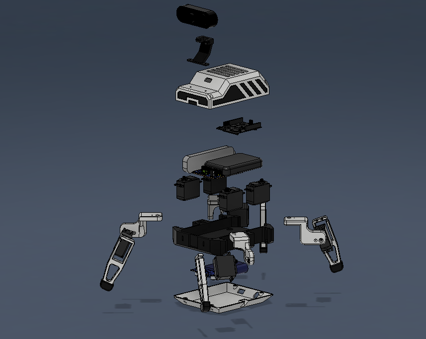

# Quadruped107

A Raspberry Pi 4 and Arduino Uno R3 quadruped with a Pi CSI camera, browser controls, and computer vision. The Pi handles video and high-level decisions; the Uno drives eight MG996R servos through a PCA9685.

## Architecture



- **Raspberry Pi 4:** serves the interface and API, captures the CSI camera with Picamera2, runs blue-ball tracking, and sends one motion step at a time over USB.
- **Arduino Uno R3 (ATmega328P):** executes the existing calibrated gait sequences and handles servo pulses, STOP commands, and heartbeat loss.
- **PCA9685:** generates the eight servo PWM signals. Servo power comes from a separate regulated supply.

The active app runs directly on Raspberry Pi OS. Arduino App Lab and Arduino Bridge are no longer required. See [architecture and serial protocol](docs/architecture.md) for the command flow and failure behavior.

## Features

- Keyboard and touch controls, including hold-to-walk and release-to-stand.
- Initial, stand, greeting, tail-wag, forward, backward, and turning routines.
- Pi camera snapshots and MJPEG streaming on the same web port.
- OpenCV blue-ball tracking with bounded motion steps and fresh-frame checks.
- Optional MediaPipe hand gestures with a separately installed model.
- Explicit servo enable, STOP button / `X` key, browser heartbeat, and Uno watchdog.
- Individual servo calibration through the Pi API.
- Fusion 360, STEP, and printable STL design files.

## Mechanical Design

The CAD assets retain the supplied robot geometry. The original mounting arrangement was sized around an UNO Q; **Pi 4 and Uno R3 mounting positions, camera mounting, cooling, and cable clearance need mechanical adaptation**. The code port does not change these CAD models.

### CAD Assembly



### Exploded View



[Exploded assembly animation](docs/Quadruped107_exploded.mp4) · [Fusion 360 archive](Design/Quadruped107.f3z) · [STEP model](Design/Quadruped107.step) · [Printable STL parts](Design/STL/)

## Hardware and Wiring

| Component | Connection / purpose |
| --- | --- |
| Raspberry Pi 4 | Raspberry Pi OS, dedicated suitable USB-C supply |
| Pi Camera Module | Pi 4 CSI camera connector via the correct ribbon cable |
| Arduino Uno R3 | USB cable from a Pi USB port; logic power and serial communication |
| PCA9685 VCC | Uno 5V, for controller logic only |
| PCA9685 SDA / SCL | Uno A4 / A5 |
| PCA9685 OE | Uno D8, plus a **10 kΩ pull-up to Uno 5V**; HIGH disables outputs |
| PCA9685 V+ | Separate regulated servo supply, sized for eight servo stall currents |
| PCA9685 GND | Uno GND and servo supply negative; common ground |
| Eight MG996R servos | PCA9685 outputs 0–7 |
| Mechanical parts | PLA structure, TPU feet, fasteners and adapted board mounts |

Use the servo manufacturer's voltage rating; the supplied design uses a battery and buck converter for the servo rail. A raw 12 V battery must not connect to servo V+. Never supply the servos from the Pi, the Uno 5V pin, or the USB cable. Use a servo power disconnect when testing. Connect the CSI ribbon with the Pi powered off. USB is the only Pi–Uno data connection; no 5 V UART signal connects to Pi GPIO.

| PCA9685 channel | Joint |
| --- | --- |
| 0 / 1 | Front-left shoulder / leg |
| 2 / 3 | Front-right shoulder / leg |
| 4 / 5 | Back-left shoulder / leg |
| 6 / 7 | Back-right shoulder / leg |

## Setup

Use a current **64-bit Raspberry Pi OS** with the modern camera stack and Python 3.11 or later. Setup commands run on the Pi unless specified otherwise.

### 1. Clone and install the Pi dependencies

```bash
cd ~
git clone https://github.com/diyan07-ctrl/Quadruped107.git
cd Quadruped107
sudo apt update
sudo apt install -y python3-venv python3-picamera2 python3-opencv python3-numpy python3-serial rpicam-apps
python3 -m venv --system-site-packages .venv
.venv/bin/python -m pip install -r Dev/Quadruped107-connect/python/requirements.txt
```

Picamera2 and libcamera must come from Raspberry Pi OS packages. Keep `--system-site-packages` so the environment can import them; do not install a separate OpenCV/NumPy wheel into this Pi environment.

### 2. Check the camera

```bash
rpicam-hello --list-cameras
rpicam-still --nopreview -o /tmp/quadruped-camera.jpg
```

If no camera is listed, resolve the CSI cable / camera configuration before starting the app. Do not enable the legacy camera stack.

### 3. Flash the Uno R3

Using Arduino IDE on a computer, open `Dev/Quadruped107-connect/sketch/sketch.ino`. Select **Arduino Uno**, install **Adafruit PWM Servo Driver Library 3.0.2** and **Adafruit BusIO 1.17.4**, and upload over USB. Then close Serial Monitor and connect the Uno to the Pi.

Alternatively, with [Arduino CLI](https://arduino.github.io/arduino-cli/) installed:

```bash
arduino-cli compile --profile uno Dev/Quadruped107-connect/sketch
arduino-cli board list
# Replace /dev/ttyACM0 with the Uno port shown above.
arduino-cli upload --profile uno --port /dev/ttyACM0 Dev/Quadruped107-connect/sketch
```

For serial access on the Pi:

```bash
sudo usermod -aG dialout "$USER"
```

Log out and back in after changing group membership. Only this app should open the Uno serial port.

### 4. Start the controller

```bash
.venv/bin/python Dev/Quadruped107-connect/python/main.py
```

Open `http://<PI_IP>:7000` from a browser on the same trusted network. Both snapshots and MJPEG use this port. No port 7001 service is needed.

The app auto-selects a single recognized Arduino / USB serial adapter. If detection is ambiguous, use a stable device path:

```bash
ls -l /dev/serial/by-id/
.venv/bin/python Dev/Quadruped107-connect/python/main.py \
  --serial-port /dev/serial/by-id/<your-uno-device>
```

The app opens USB serial, waits for the Uno bootloader, verifies the firmware identity, and leaves servo outputs disabled. It never automatically replays a previous command after reconnecting.

### 5. First movement

Start with servo power disconnected. Confirm the web app, camera, and Uno connection. Support the robot, verify the wiring and OE pull-up, then connect servo power. Select **Enable servos**, then test one pose at a time.

The inherited pulse values are a starting point, not calibration for your assembly. Verify joint direction and mechanical clearance before walking. See [calibration and API examples](Dev/Quadruped107-connect/README.md).

## Controls

| Input | Action |
| --- | --- |
| Enable servos | Arm outputs; does not issue a pose |
| STOP / X | Abort motion and disable servo outputs; enable again to resume |
| W / S | Forward / backward while held |
| A / D | Turn left / right while held |
| Release movement input | Finish the current gait step, then stand |
| Arrow Down / Up | Initial / stand |
| Arrow Right / Left | Greeting / tail wag |
| Space / Page Down | Manual / blue-ball tracking |
| F4 | Hand gestures, when a supported model is configured |
| Escape | Toggle fullscreen view |

Closing, hiding, or leaving the control page disables outputs. A missing browser heartbeat also disables outputs, including in vision modes. Keep one control browser active. The web server has no login and is intended for a trusted local network, not direct Internet exposure.

## Optional Hand Gestures

The previous UNO Q / Edge Impulse brick and its `.eim` model are not used on the Pi. A standard MediaPipe Tasks Gesture Recognizer can be enabled with a compatible `.task` model. See [optional gesture setup](Dev/Quadruped107-connect/README.md#optional-hand-gestures). Without it, manual control, Pi camera video, and blue-ball tracking still work; the gesture button is disabled.

## Run at Login / Boot

An optional [systemd user service](deploy/quadruped107.service) is provided for a checkout at `~/Quadruped107`:

```bash
mkdir -p ~/.config/systemd/user
cp deploy/quadruped107.service ~/.config/systemd/user/
systemctl --user daemon-reload
systemctl --user enable --now quadruped107
journalctl --user -u quadruped107 -f
```

For startup without an interactive login, enable lingering with `sudo loginctl enable-linger "$USER"`. Edit the service paths if your checkout lives elsewhere. Automatic service restarts still leave servo outputs disabled.

## Development and Validation

Hardware-free simulation works on a computer with Python 3.11+:

```bash
python -m venv .venv
# Windows: use .venv\Scripts\python.exe for the commands below.
.venv/bin/python -m pip install -r Dev/Quadruped107-connect/python/requirements-dev.txt
.venv/bin/python Dev/Quadruped107-connect/python/main.py --simulate --host 127.0.0.1
.venv/bin/python -m unittest discover -s tests -v
```

Simulation displays a synthetic camera feed and never opens a serial port. See [validation results and hardware checklist](docs/validation.md). A successful compile or simulation does not establish that the assembled robot is calibrated or camera capture works on your Pi.

## Project Layout

```text
Design/                              Fusion, STEP and STL design assets
Dev/Quadruped107-connect/
  assets/                            Browser interface
  python/                            Pi camera, vision, serial transport and API
  sketch/                            Uno R3 firmware and existing gait tables
Dev/Tools/                           Legacy UNO Q tools; not part of the Pi runtime
deploy/                              Optional systemd user service
docs/                                Architecture, validation and CAD images
tests/                               Hardware-free behavior tests
```

## License and Changes

Licensed under [GNU GPL v3.0](LICENSE). Rebranded by diyan07-ctrl on 2026-11-04. The Pi 4 / Uno R3 port replaces the UNO Q runtime, camera pipeline and bridge transport while retaining the supplied servo channel map, gait targets, and design assets.
