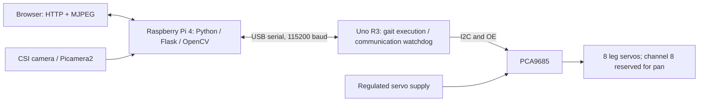

# Quadruped107

An 8-DOF quadruped for ENR107 Digital Electronics, using Raspberry Pi 4 for vision and control and Arduino Uno R3 for motion.

The assembled robot has two servos per leg. The existing software provides browser controls, CSI camera video, blue-ball tracking, optional hand gestures, and explicit servo enable/stop controls. Phase 0 establishes the repository and architecture; physical calibration and autonomous obstacle avoidance remain pending.

## Architecture



Servo power is separate from logic power, with common ground. Never connect raw 2S Li-ion voltage to 6 V-rated servos. STOP disables PWM and can remove holding torque; retain a physical servo-power disconnect.

## Hardware

Raspberry Pi 4, Uno R3, PCA9685, eight MG996R/MG995-family servos, CSI camera, URM37, HC-SR04, 3–5 touch sensors, three 7.4 V / 1800 mAh battery packs, and a USB power bank. Pi 5, camera-pan servo, and SSD1306 OLED are optional. Sensor revisions and power ratings require verification.

## Repository

| Location | Contents |
| --- | --- |
| [firmware/uno](firmware/uno/README.md) | Uno sketch and inherited gait tables |
| [software/pi](software/pi/README.md) | Pi application and packaged browser assets |
| [hardware](hardware/README.md) | CAD, printable parts, calibration spreadsheets |
| [docs](docs/PROJECT.md) | Architecture, wiring, safety, roadmap, validation |
| [tests](tests/) / [tools](tools/) | Hardware-free tests and repository checks |
| [deploy](deploy/) | Optional systemd user service |
| [archive/uno-q](archive/uno-q/README.md) | Historical applications; excluded from active runtime |

## Quick start

Hardware-free development with Python 3.11+:

```bash
python -m venv .venv
# Windows: replace .venv/bin/python with .venv/Scripts/python.exe
.venv/bin/python -m pip install -r software/pi/requirements-dev.txt -e software/pi
.venv/bin/python -m quadruped.main --simulate --host 127.0.0.1
```

Open `http://127.0.0.1:7000`. Simulation opens no hardware. For actual Pi installation, camera checks, firmware flashing, and boot setup, follow [SOFTWARE](docs/SOFTWARE.md), then [SAFETY](docs/SAFETY.md) before enabling servos.

## Documentation and status

[Project](docs/PROJECT.md) · [Architecture](docs/ARCHITECTURE.md) · [Hardware](docs/HARDWARE.md) · [Wiring](docs/WIRING.md) · [Software](docs/SOFTWARE.md) · [Protocol](docs/PROTOCOL.md) · [Safety](docs/SAFETY.md) · [Roadmap](docs/ROADMAP.md) · [Validation](docs/VALIDATION.md) · [Audit](docs/AUDIT.md)

Existing vision features are retained implementations, not evidence that later phases have passed. Local sensing, sensor telemetry, a hardware watchdog, and physical stop integration are not implemented. See validation for actual checks and remaining hardware work.

Created by Diyan Patel — ENR107 Digital Electronics.

Licensed under [GNU GPL v3](LICENSE). Existing source notices and Git history are retained; see [credits](AUTHORS.md).
