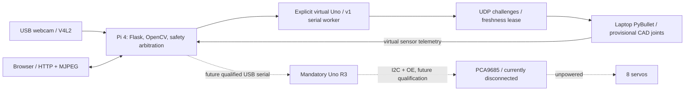

# Quadruped107

An eight-joint quadruped for ENR107 Digital Electronics, with Raspberry Pi 4 vision and an Arduino Uno R3 motion controller.

Phase 3 adds stable blue/yellow target tracking, persisted dashboard preferences, explainable virtual decisions and bounded interactions. [Run the integrated laptop demonstration](docs/PHASE3.md); no Raspberry Pi access is required.

This branch develops software before physical locomotion. It supports USB webcam capture, blue/yellow-target detection, browser control, a virtual Uno and an eight-joint CAD-mesh PyBullet fixture. Physical ARM is inhibited. The suspected damaged PCA9685 must remain disconnected and all servos unpowered.

## Architecture



Camera acquisition, perception and motion safety have separate workers. Old observations, missing targets, browser lease loss and simulator failure inhibit virtual motion. Explicit re-enable is required after STOP or a fault. Simulation never replaces missing physical hardware automatically.

## Start without hardware

Python 3.11+ from the checkout:

```bash
python -m venv .venv
# Windows: use .venv/Scripts/python.exe
.venv/bin/python -m pip install -r software/pi/requirements-dev.txt -e software/pi
.venv/bin/python -m quadruped.main --simulate --host 127.0.0.1
```

Open http://127.0.0.1:7000. Enable **virtual actuators** explicitly before choosing a mode. For a real Pi USB camera with simulated outputs, use [deployment](deploy/README.md). For the laptop model and integrated pipeline, use [simulation](simulation/README.md).

## Repository

| Path | Contents |
| --- | --- |
| [software/pi](software/pi/README.md) | Flask, camera backends, vision, controller, virtual Uno, web assets |
| [firmware/uno](firmware/uno/README.md) | Preserved production firmware and gait tables |
| [simulation](simulation/README.md) | CAD-derived visuals, provisional URDF, PyBullet and bridge |
| [hardware](hardware/README.md) | Original CAD, STL and calibration assets |
| [hardware/Power](hardware/Power/README.md) | Conditional power design and reproducible budgets |
| [docs](docs/PROJECT.md) | Architecture, safety, protocol, calibration and evidence |
| [tests](tests/) / [tools](tools/) | Regression, packaging, model and repository checks |
| [deploy](deploy/README.md) | Isolated Pi installation and foreground launch scripts |
| [archive/uno-q](archive/uno-q/README.md) | Historical code, excluded from active runtime |

## Hardware and status

[Phase 3 demonstration](docs/PHASE3.md) · [Phase 2 architecture](docs/PHASE2.md) · [Sensor contract](docs/SENSORS.md) · [Model investigation](docs/MODEL_STUDY.md)

Physical sensor drivers, qualified stopping and walking remain pending. The optional planar proxy represents kinematic navigation, not gait-derived locomotion.

Primary: Pi 4 Model B (2 GB), mandatory Uno R3, eight MG996R/MG995-family servos and PCA9685. The functional USB2.0 PC CAMERA is the current camera candidate; CSI/Picamera2 remains optional. URM37, HC-SR04, touch sensors, three 7.4 V/1800 mAh packs and a power bank await module/power qualification. Pi 5, pan servo and OLED remain optional.

Automated software and simulated integration evidence is in [VALIDATION](docs/VALIDATION.md). SSH access was blocked before authentication, so no new Pi performance or physical camera results are claimed. The articulated model uses original mesh surfaces with provisional pivots, masses and calibration; it does not establish physical walking feasibility.

[Architecture](docs/ARCHITECTURE.md) · [Software](docs/SOFTWARE.md) · [Protocol](docs/PROTOCOL.md) · [Safety](docs/SAFETY.md) · [Calibration](docs/CALIBRATION.md) · [Hardware verification](docs/HARDWARE_VERIFICATION.md) · [Roadmap](docs/ROADMAP.md) · [Design decisions](docs/DECISIONS.md)

Created by Diyan Patel — ENR107 Digital Electronics.

[GNU GPL v3](LICENSE). Existing attribution and Git history are retained; see [credits](AUTHORS.md).
