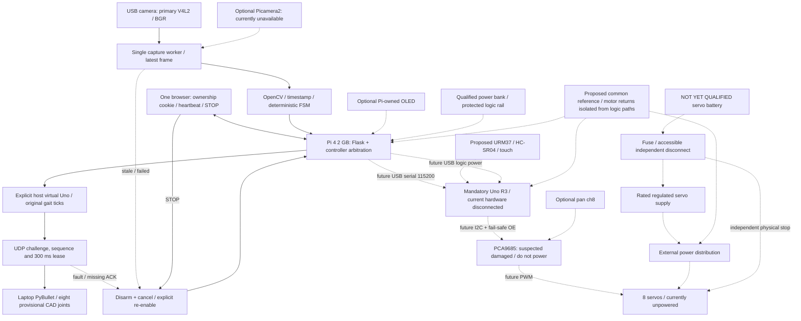
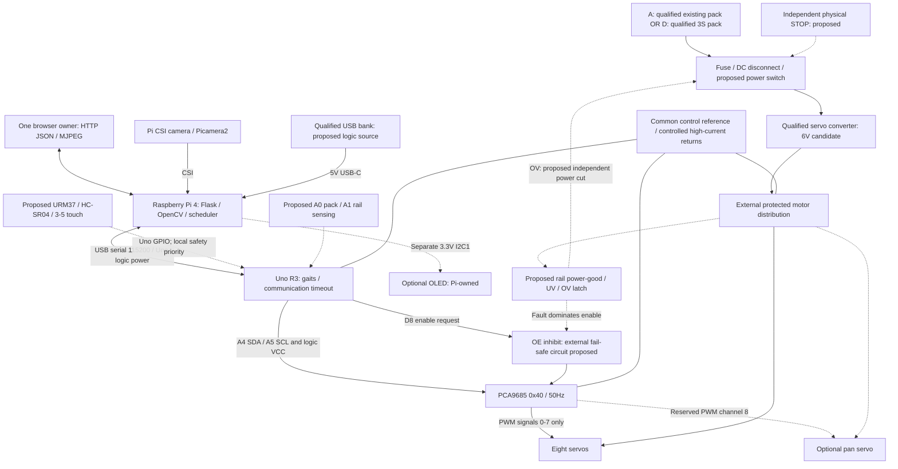
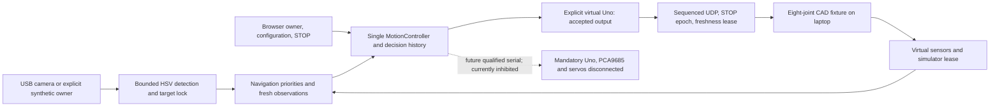

# Architecture freeze — Phase 0.1

## Current Phase 2 virtual architecture

[Phase 2](PHASE2.md) adds one SensorManager, a deterministic Navigation policy and additive UDP sensor acknowledgments to the existing controller/serial architecture. [Sensor contracts](SENSORS.md) define validity, freshness, touch debounce and extra simulated swept-clearance evidence. Exploration has no camera dependency; tracking retains the existing detector and stale-frame protections.

Independent sensor callbacks/admission/guard checks preempt motion; manual takeover, Idle, STOP and faults cancel generations and disarm. Fresh disarmed acknowledgment is required before reconnect/re-arm. The [scenario guide](../simulation/PHASE2.md) labels the optional planar proxy separately from walking physics. No physical firmware or hardware interface is activated. Earlier Phase 1 sections below describe the retained baseline.

## Active software-integration architecture

Historical Phase 1 baseline: Phase 0.1 commit a629397. PRs #1–#7 are now merged into their recorded stacked target branches; Phase 4/5 remain absent from main until the release PR is reviewed. The [current architecture and authority table](SENSOR_COMMISSIONING_RELEASE.md) supersedes these historical baseline descriptions. Physical ARM is prohibited even when a serial device exists. The diagram separates the virtual path from future electrical connections:

Solid arrows are implemented software flows; they do not assert real Pi execution in this session. Dashed electrical connections are proposed and unverified. No power circuit was constructed or switched. See [Power](../hardware/Power/README.md).

The active blue-target FSM has IDLE, TARGET_LEFT/CENTER/RIGHT, TARGET_LOST, optional bounded SEARCHING, CAMERA_FAULT, STOPPED, MANUAL_OVERRIDE and virtual OBSTACLE_BLOCKED. Perception requests enter the existing generation-aware controller; they never directly write serial or joint outputs. Center requests stand; missing/stale observations and STOP inhibit motion. Faults require explicit enable. A separate bridge guard stops on network failure even if vision is blocked.

The mandatory Uno remains the future deterministic gait/PCA/sensor owner. Its production code and gait tables are preserved byte-for-byte. The host emulator reuses their generated target data; the optional generated virtual firmware retains its parser/watchdog but stubs GPIO/I2C output and has a distinct identity. Neither is evidence of physical Uno/PCA behavior.

The fixed-base CAD fixture validates software integration and finite articulated output. Joint origins, axes, collision/inertial properties and tick mapping are provisional. See [model limitations](../simulation/README.md) and [current software timing/resource targets](SOFTWARE.md). Earlier physical architecture sections below remain future design contracts, not authorization to actuate.

This is a conditional design freeze. Solid control paths are implemented unless explicitly labelled proposed; power wiring and sensor circuits have not been physically verified. [Decisions](DECISIONS.md), [Power](../hardware/Power/README.md) and [HARDWARE_VERIFICATION](HARDWARE_VERIFICATION.md) govern the freeze.

Power domains are independent supplies with common reference, not galvanic isolation. PWM inhibition does not remove motor power. The proposed supervisor must prevent motion on partial power and rail restoration; it does not exist in current hardware evidence.

## Responsibility and control hierarchy

Pi owns camera, image processing, behavior selection, HTTP, mode management and telemetry presentation. Uno owns the sole servo I2C bus, deterministic gait sequences, and the communication watchdog. Local sensing, joint-limit enforcement, hardware watchdog and rail/physical-stop logic are assigned to Uno or independent circuits and staged into Phase 1/2 as specified.

Priority is emergency stop/hardware fault → local safety → manual → interaction → autonomy → idle. No feature may write PWM around this path. A single MotionController reserves ARM/MOVE/SERVO transactions, serializes submission under a short state lock and never holds that lock while awaiting acknowledgments. STOP cancels previous intent and pending transport work. The serial worker alone performs USB I/O.

The first HTTP ARM claims one browser cookie lease; other clients cannot move or renew it. Any same-origin client may STOP. Requests validated before a STOP/mode change carry a generation check so they cannot act in a newer session. Cookie ownership is arbitration, not authentication; trusted LAN remains required.

```mermaid
stateDiagram-v2
    [*] --> Disabled
    Disabled --> Arming: explicit owner ARM
    Arming --> EnabledIdle: matching acknowledgment and generation
    Arming --> Disabled: STOP / timeout / link change
    EnabledIdle --> Manual: fresh pose or direction
    EnabledIdle --> Tracking: selected mode / fresh camera
    Manual --> EnabledIdle: one step completed / no repeat
    Tracking --> EnabledIdle: owner selects manual while idle
    Manual --> Disabled: STOP / stale intent / lease or link fault
    Tracking --> Disabled: STOP / camera or lease fault
    EnabledIdle --> Disabled: STOP / fault
    Disabled --> Disabled: reconnect or rail fault; no replay
```

Busy control-mode switches reject rather than waiting behind a long routine. Latest pose/direction selection may replace unsent intent during MOVE; stand remains the release intent. Old action intent expires after 500 ms; held direction is renewed only by the owner's matching heartbeat. Inference submissions are tied to the captured control generation and arming session; delayed results cannot cross a STOP/re-arm. A failed active MOVE latches a stop even if a newer desired direction exists. Explicit re-arm clears a fault only after the STOP barrier/previous operation retires.

## Timing, blocking and resource gates

| Path | Implementation / design target |
| --- | --- |
| Camera | One capture owner, queue=False, latest frame only, requested 640×480 at 20 fps; actual target ≥10 fresh fps |
| Frame age | 0.8 s publication expiry implemented; exposure timestamp/clock-domain age still requires HV14 measurement |
| Vision | Separate worker, 60 ms wait, two stable observations and 1.5 s cooldown; completed result must be ≤500 ms old from publication; independent 0.8 s observation guard inhibits a blocked worker |
| Browser | 250 ms heartbeat, 1 s lease and 50 ms guard; background timers can throttle and therefore disarm |
| Serial | One I/O owner, four ordinary pending max, one coalesced urgent STOP, 250 ms ordinary queue TTL; no replay |
| I/O blocking | Serial reads 50 ms, writes up to configured 500 ms; STOP cannot retract a write already started |
| Completion | ARM/SERVO 3 s, STOP 2 s, MOVE 20 s deadlines including queued time; timeout disconnects/disarms |
| Heartbeats | PING 300 ms; host missing-PONG 1.2 s; Uno PING timeout >1.5 s when loop responsive |
| Host dispatch | Target ≤100 ms normal command dispatch; STOP dispatch target ≤100 ms in normal load, not worst-case guarantee |
| Physical stop | Measure USB-to-OE and torque loss separately; no certified stop latency is claimed |
| Uno | Current 998 bytes globals; future ≤1300 bytes globals, ≥400 bytes measured stack margin, ≤28 KiB flash target |
| Pi 4 | Target app RSS <1 GiB, process CPU <200%, capture-to-display <250 ms with one viewer; all unmeasured |
| Recovery | Target reconnect/identity within 8 s after a device becomes available; explicit ARM required |
| Shutdown | Stop motion/link before camera teardown; joins are bounded attempts; systemd allows 20 s before forced termination, not proof native calls terminated |

Hidden waits remain: Picamera2 capture, JPEG encoding, inference, HTTP streaming socket writes, serial OS writes, repeated I2C transactions and thread joins. Uno cooperative delays service serial, but a bus/MCU freeze still needs independent watchdog/hardware protection. A 1 s hardware-watchdog candidate and progress/brownout design are in [SAFETY](SAFETY.md). Driver buffers/threads and viewer count require load qualification; no bounded HTTP-worker claim is made.

## Phase 1–5 expansion

Versioned offline [calibration profiles](CALIBRATION.md) preserve inherited targets. [EXTENSIONS](EXTENSIONS.md) freezes optional TEL1 telemetry, pins, freshness, local fault policy and SRAM budgets. Optional OLED moves to Pi's separate 3.3 V bus; camera pan stays reserved/off. Person/object inference remains a Pi worker publishing expiring motion intent.

No ROS 2, cloud inference, paid APIs, database, heavyweight frontend or broker is required. [Power candidates A/D](../hardware/Power/README.md) preserve the same control topology when the source changes; no structural software redesign is needed.

## Phase 3 integration

[Phase 3](PHASE3.md) retains the single MotionController and virtual Uno output path. A revisioned target lock publishes fresh observations; bounded navigation/personality requests pass through existing ownership, sensor and simulator gates. Configuration changes stop/disarm and invalidate in-flight observations. No automatic re-arm follows a fault or preference change.

