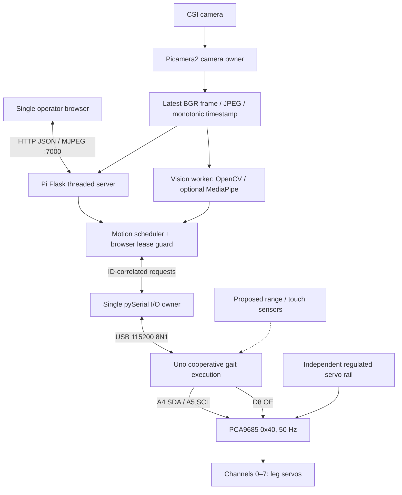

# Architecture

## System responsibilities

Pi 4 owns camera capture, image processing, behavior selection, HTTP control, status presentation, scheduling, and mode management. Optional future AI inference belongs here. Pi 5 uses the same application; camera cable, OS packages, supply, and cooling still need qualification.

Uno R3 owns PWM-driver communication and gait execution. Local sensing, bounded joint limits, local safety arbitration, physical stop input, and an MCU hardware watchdog are assigned to Uno but are future work. The existing communication watchdog is a software timeout serviced by the cooperative loop; it cannot recover a frozen MCU.

PCA9685 generates pulses independently of video processing. It is not a motion planner or safety controller. Only Uno owns its I2C bus. D8 controls OE, with an external pull-up proposed to inhibit outputs during reset.

## Ownership and motion hierarchy

Priority is: (1) emergency stop / hardware fault, (2) local safety override, (3) manual control, (4) interaction behaviors, (5) exploration/tracking, (6) idle. A stop must cancel pending intent and require explicit re-enable. Future sensor behaviors must publish through the same arbitration path, and local safety must preempt Uno motion without a Pi round trip.

Current software uses exclusive manual, OpenCV, or gesture modes, a single desired motion, and generation numbers that prevent old completions replacing new intent. Manual mode preempts vision by selecting manual mode; interaction and exploration states are not implemented. There is no multi-operator ownership token: use one visible control browser.

```mermaid
stateDiagram-v2
    [*] --> Disabled
    Disabled --> EnabledIdle: explicit ARM / acknowledged
    EnabledIdle --> Manual: manual pose or direction
    EnabledIdle --> Tracking: selected vision mode / fresh camera
    Manual --> EnabledIdle: step completed without repeat
    Manual --> Tracking: mode switch clears direction / stand
    Tracking --> Manual: explicit manual selection
    Tracking --> Disabled: expired camera / vision failure
    Manual --> Disabled: STOP / lease loss / link fault
    EnabledIdle --> Disabled: STOP / lease loss / link fault
    Disabled --> Disabled: reconnect / reset; discard intent
```

Release-to-stand finishes the current step before standing; it is not an emergency stop. Future interaction and exploration modes enter through the scheduler below manual priority. Faults must inhibit them.

## Flows and timing

One camera thread publishes only the latest frame; vision consumes new sequence numbers. Serial PING and STOP servicing continue while the gait waits cooperatively. HTTP handling does not wait for video inference, although ARM, STOP, and calibration endpoints may wait for serial completion.

| Path | Existing setting | Design target / qualification |
| --- | --- | --- |
| Camera | 640 × 480; requested 20 fps; 50 ms additional wait | At least 10 fresh fps; capture-to-display below 250 ms on trusted LAN |
| Vision | 60 ms worker wait; two stable frames; 1.5 s action cooldown | At least 10 processed fresh fps when enabled |
| Frame expiry | 0.8 s after publication | Measure capture age too; capture timestamps/backlog handling need review |
| Browser heartbeat / state polling | 250 ms / 750 ms | Typical command dispatch below 100 ms; status below 1 s |
| Browser lease guard | 1 s lease; 50 ms checks | Disarm initiation within 1.1 s after last heartbeat |
| Serial PING / missing PONG | 300 ms / 1.2 s | No unnecessary acknowledgment per PWM update |
| Uno communication watchdog | More than 1500 ms without PING while armed | Inhibit after timeout when loop remains responsive |
| Stop to OE | Cooperative parser and I2C work | Below 100 ms under normal load; measure, not guaranteed |
| Future range / touch | Not implemented | 5–10 Hz range, 100 Hz touch scan; bounded nonblocking acquisition |
| Resource budget | Not measured | Below 1 GiB app RSS and 200% process CPU on Pi 4, one viewer |

All budgets are engineering targets, not measured results or hard real-time guarantees. Current pulse ramps and I2C transactions are deterministic sequences but not a formally bounded scheduler. Multiple I2C timeout delays, serial queueing, or a frozen MCU can exceed the stop target. Future safety work must address these limits.

## Failure architecture

Startup, HELLO, reset, reconnect, browser lease loss, STOP, and communication faults inhibit outputs or clear Pi intent. Camera expiry stops vision modes; manual mode can operate without a camera. A command timeout drops queued work and forces reconnection; explicit enable is required afterward.

OE inhibits signals, not servo power. Loss of torque can collapse the chassis. A physical servo-power disconnect is required. Runtime I2C write failures are not comprehensively detected; a physical stop circuit and hardware watchdog are still missing. See [SAFETY](SAFETY.md) and [PROTOCOL](PROTOCOL.md).
