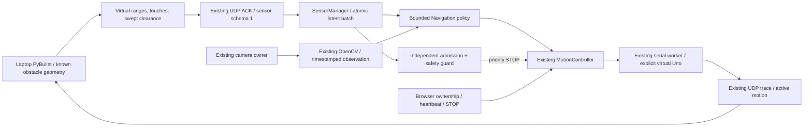
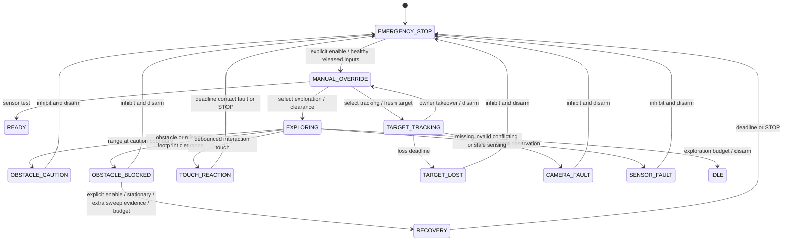

# Phase 2: virtual autonomy

Phase 2 extends unmerged Phase 1 head a15c397. [PR #4](https://github.com/diyan07-ctrl/Quadruped107/pull/4) is stacked on phase1/software-vision-digital-twin. No Pi, GPIO, sensor, Uno, PCA9685 or servo connection is used. Physical ARM remains rejected.

## Implemented responsibilities

SensorManager validates units, type/range, source and transport age, duplicates, conflicts and touch debounce. Navigation selects intents; it never owns hardware or writes serial. MotionController remains the only motion executor, with the existing generations, browser lease and STOP queue. A sensor callback can submit nonblocking priority STOP immediately, and the independent controller guard rechecks at 50 ms intervals. Admission checks also run before serial submission. These are software policies, not guaranteed physical stop times.

## Modes

| API mode | Dashboard | Policy |
| --- | --- | --- |
| manual | Manual | Owner controls; critical sensor/contact and movement-clearance gates still apply |
| opencv | Blue target tracking | Existing blue detector/FSM; turn/stand only, never camera-only forward |
| explore | Virtual exploration | One forward gait at a time with front range and footprint evidence |
| sensor_test | Virtual sensor test | Observations only, no autonomous movement |
| idle | Idle | Cancel, STOP and disarm |
| hand_gesture | Phase 1 only | Not exposed by Phase 2; optional existing implementation preserved |

Virtual sensors require explicit protocol virtual actuators and a simulator endpoint (or an explicitly injected automated-test backend). Missing telemetry never selects a fixture automatically. No autonomous mode starts at boot. Mode selection requires the browser owner. Manual takeover during autonomy cancels/disarms; explicit enable is required before further manual motion. Idle also disarms. Stale generation requests cannot change the mode after STOP/re-arm.

## States and transitions

The runtime can quickly progress from a cause-specific state to EMERGENCY_STOP after disarming. Bounded transition history, sensor errors and the controller's latched first fault retain the cause.

Priority: STOP/fault > communication failure > critical sensing/contact failure > manual takeover > obstacle policy > touch interaction > selected tracking or exploration > idle. Tracking and exploration are mutually exclusive. A front range sensor cannot authorize left/right/reverse clearance. Separate simulator-only swept-region evidence is mandatory for those directions; no such physical evidence is implemented.

## Conservative policy

Editable [settings](../deploy/navigation.example.json): blocked ≤0.35 m, caution ≤0.60 m, clear release ≥0.65 m after caution, command period ≥1.25 s, exploration budget 30 s. Caution inhibits rather than reducing an uncalibrated gait's speed. All distances and speeds are provisional simulation assumptions.

A moving robot meeting an obstacle stops/disarms first. On a later explicit enable, stationary exploration can request one turn only with fresh swept-volume evidence. Recovery lasts at most 0.6 s, with two attempts per application process; it ends in STOP/disarm. There is no automatic retreat, infinite turning or claimed dead-end escape. A one-cycle gait may be interrupted by that budget.

Head/back touches select existing greeting/tail_wag routines for a maximum two-second fragment. They are cancellable, may not complete the full inherited routine, and never introduce new servo targets. Held input does not retrigger; side/body contacts or simultaneous contacts inhibit. All touch inputs must be released before re-enable.

## Running and evidence

Use [simulation setup](../simulation/PHASE2.md), [sensor contract](SENSORS.md), [validation](VALIDATION.md) and [model investigation](MODEL_STUDY.md). No additional dependency was added. Production firmware, serial v1, calibration, CAD and licenses remain preserved. Physical sensor adapters and qualified locomotion remain future work.
