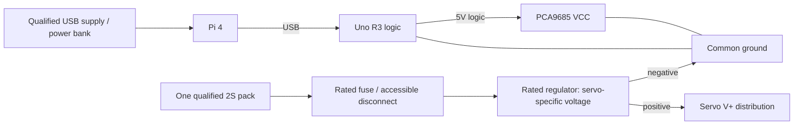

# Proposed wiring

Current checkpoint (12 November 2026): [executed non-actuating release report](SENSOR_COMMISSIONING_RELEASE.md) and [exact sensor-only bench procedure](SENSOR_BENCH.md). Interface allocations are not electrical qualification; physical ARM remains inhibited. Earlier checkpoints below retain their historical scope.

## Phase 2 virtual-only interfaces

No sensor wiring is performed or validated. Virtual URM37/HC-SR04 identities describe configurable ray approximations, not known module revisions. Proposed physical assignments below remain unverified and must be checked against actual pin labels/mode/supply/logic levels before use. Real ultrasonic triggers must be scheduled to avoid acoustic crosstalk; simultaneous virtual rays do not qualify that behavior. See [sensor contract](SENSORS.md).

## Assignment wiring restriction

**VERIFIED in this session:** no physical wiring; SSH could not reach the Pi. **USER-REPORTED:** working USB webcam on Pi, Uno disconnected, CSI faulty. **PROHIBITED:** powering the suspected damaged PCA9685, energizing servos, uploading/connecting actuator hardware or switching physical power.

Use only USB webcam → Pi and the trusted-LAN software bridge to a laptop. All Uno/PCA/OE/sensor/battery connections below are future PROPOSED or HARDWARE-DEPENDENT design assignments. They do not describe an assembled safety circuit. The [architecture diagram](ARCHITECTURE.md) separates software and future power paths; see [power distribution](../hardware/Power/DISTRIBUTION.md).

**No assembled electrical connection has been physically verified during Phase 0.** VERIFIED-IN-SOURCE means firmware assignment only. PROPOSED means an allocated connection. HARDWARE-DEPENDENT means verify the exact module before wiring. Original [electrical image](images/electrical-diagram.png) is historical and is not the Pi/Uno wiring authority.

## Pin allocation

| Endpoint | Connection | Status |
| --- | --- | --- |
| Pi USB-A | Uno USB-B; data and Uno logic power | PROPOSED |
| Pi CSI | Camera via correct model-specific ribbon, fitted powered off | HARDWARE-DEPENDENT |
| Uno A4 / A5 | PCA9685 SDA / SCL | VERIFIED-IN-SOURCE |
| Uno 5V | PCA9685 VCC logic only | PROPOSED |
| Uno D8 | PCA9685 OE; external 10 kΩ pull-up to Uno 5V | VERIFIED-IN-SOURCE pin; PROPOSED circuit |
| Uno GND | PCA GND, regulator negative, sensor ground | PROPOSED |
| Regulated servo positive | External fused servo distribution; do not use PCA V+ as motor trunk unless qualified | HARDWARE-DEPENDENT ratings |
| Uno D0/D1 | Reserve for USB UART; no sensors | PROPOSED reservation |
| Uno D4 / D2 | URM37 trigger output / pulse input | HARDWARE-DEPENDENT |
| Uno D5 / D3 | Optional HC-SR04 trigger / echo | HARDWARE-DEPENDENT |
| Uno D6, D7, D9, D10, D11 | Touch inputs 1–5; populate available 3–5 | HARDWARE-DEPENDENT |
| Uno D12 | Future physical-stop status input | PROPOSED; no driver |
| Uno D13 | Built-in status LED; no external assignment | PROPOSED reservation |
| Uno A0 / A1 | Pack / servo-rail monitoring through qualified divider and protection | HARDWARE-DEPENDENT |
| Uno A2 / A3 | Spare | PROPOSED reservation |
| Pi GPIO2 / GPIO3 (physical 3/5) | Optional SSD1306 on Pi I2C1, 3.3 V-compatible only | HARDWARE-DEPENDENT |

PCA channels 0–7 follow the [joint map](HARDWARE.md); channel 8 is reserved for camera pan. Current firmware only addresses 0–7; connecting a pan servo does not enable software support. Leave 9–15 unassigned.

## Sensor precautions

Use URM37 PWM/pulse mode so USB UART remains dedicated to Pi communication. Map by the verified signal names, never by assumed connector position. Do not connect RS232-level signals to TTL GPIO. Revisions differ in configuration and timing; no pulse-width conversion is approved until its own manual is matched to the board. See [manufacturer interface guidance](https://wiki.dfrobot.com/sen0001/docs/21981).

Power sensors only at their verified rating, with compatible logic levels. A typical HC-SR04 5 V echo belongs on Uno, not Pi GPIO; check the actual module. Use bounded, nonblocking pulse timing in the later driver; do not add long pulseIn waits to the gait loop. Range sensors must not trigger simultaneously.

Touch inputs require verified active polarity, output type, and supply. Use INPUT_PULLUP only for a dry contact/open-drain interface that supports it; push-pull touch modules require suitable input wiring. Record placement and debounce after inspection.

OLED is Pi-owned: use Pi I2C1 physical 3 SDA / 5 SCL, physical 1 3.3 V and physical 6 GND only after module/pull-up compatibility verification. No 5 V I2C pull-up may reach Pi GPIO. Uno owns its separate A4/A5 servo/sensor bus; do not bridge these buses.

## Power and stop proposal

Never feed raw 2S voltage to 6 V-rated servos, or servo current through Pi/Uno pins, USB, or solderless breadboard rails. Size supply, fuse, connector, and wiring for verified operating and transient loads. PCA terminal/trace capacity may require a separate distribution block.

Route high-current returns to the power distribution point; retain a solid logic reference and local decoupling. Prevent servo current from flowing through thin logic-ground wiring. Verify polarity and unloaded regulation before attaching servos.

D8 HIGH inhibits PWM. Confirm breakout OE behavior and pull-up against its schematic; some boards contain a pull-down that must be accommodated. A future physical stop should disconnect servo power independently of software; D12 is status only and must not be represented as a working stop. Verify switch/DC interrupt ratings and safe restart behavior before use.

## Phase 0.1 distribution amendment

Use the [final architecture diagram](ARCHITECTURE.md) and [Power distribution](../hardware/Power/DISTRIBUTION.md). A single servo rail is the minimum-cost candidate; a split positive-rail variant must not join branches via PCA V+ headers. Prefer external positive/return motor distribution and PWM-only connections. All hardware remains proposed.

A0/A1 are reserved for pack/rail sense; no raw battery connection is permitted. Divider ratio, ADC reference, maximum fault voltage, leakage/clamps and logic-absent behavior require HV13 qualification. The independent power-good/UV/OV latch must inhibit OE and require explicit restart after servo-rail restoration. D12 is stop status only; it does not provide the independent power disconnect.

A pull-up to Uno 5V is insufficient proof of safety when logic is absent and servo power remains. Verify breakout partial-power behavior and a qualified fail-safe buffer/supervisor circuit. [HARDWARE_VERIFICATION](HARDWARE_VERIFICATION.md) is the single unresolved-hardware register.
# Phase 5 sensor-only software boundary

The D4/D2 URM37, D6/D7/D9/D10/D11 touch and Pi-owned OLED allocations below remain conditional on actual board revision, interface mode, polarity and voltage identification. Only the explicitly selected V5 PWM-trigger profile is implemented; other URM37 revisions/modes are not auto-detected. HC-SR04 has no enabled physical driver. The new sensor-only target initializes no unconfigured interfaces and has no actuator driver. Keep it isolated from servos/PCA during first tests. See [exact next-session sensor procedures](SOFTWARE_READINESS.md). No wiring changes were made during software qualification.
