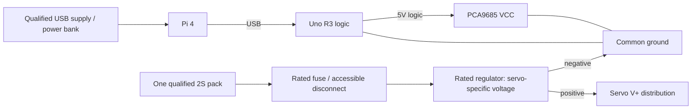

# Proposed wiring

**No assembled electrical connection has been physically verified during Phase 0.** VERIFIED-IN-SOURCE means firmware assignment only. PROPOSED means an allocated connection. HARDWARE-DEPENDENT means verify the exact module before wiring. Original [electrical image](images/electrical-diagram.png) is historical and is not the Pi/Uno wiring authority.

## Pin allocation

| Endpoint | Connection | Status |
| --- | --- | --- |
| Pi USB-A | Uno USB-B; data and Uno logic power | PROPOSED |
| Pi CSI | Camera via correct model-specific ribbon, fitted powered off | HARDWARE-DEPENDENT |
| Uno A4 / A5 | PCA9685 SDA / SCL | VERIFIED-IN-SOURCE |
| Uno 5V | PCA9685 VCC logic only | PROPOSED |
| Uno D8 | PCA9685 OE; external 10 kΩ pull-up to Uno 5V | VERIFIED-IN-SOURCE pin; PROPOSED circuit |
| Uno GND | PCA GND, regulator negative, sensor ground | PROPOSED |
| Regulated servo positive | PCA9685 V+ / appropriate servo distribution | HARDWARE-DEPENDENT ratings |
| Uno D0/D1 | Reserve for USB UART; no sensors | PROPOSED reservation |
| Uno D4 / D2 | URM37 trigger output / pulse input | HARDWARE-DEPENDENT |
| Uno D5 / D3 | Optional HC-SR04 trigger / echo | HARDWARE-DEPENDENT |
| Uno D6, D7, D9, D10, D11 | Touch inputs 1–5; populate available 3–5 | HARDWARE-DEPENDENT |
| Uno D12 | Future physical-stop status input | PROPOSED; no driver |
| Uno D13 | Built-in status LED; no external assignment | PROPOSED reservation |
| Uno A0–A3 | Spare; analog use possible after allocation review | PROPOSED reservation |
| Uno A4/A5 | Optional SSD1306, shared bus | HARDWARE-DEPENDENT |

PCA channels 0–7 follow the [joint map](HARDWARE.md); channel 8 is reserved for camera pan. Current firmware only addresses 0–7; connecting a pan servo does not enable software support. Leave 9–15 unassigned.

## Sensor precautions

Use URM37 PWM/pulse mode so USB UART remains dedicated to Pi communication. Map by the verified signal names, never by assumed connector position. Do not connect RS232-level signals to TTL GPIO. Revisions differ in configuration and timing; no pulse-width conversion is approved until its own manual is matched to the board. See [manufacturer interface guidance](https://wiki.dfrobot.com/sen0001/docs/21981).

Power sensors only at their verified rating, with compatible logic levels. A typical HC-SR04 5 V echo belongs on Uno, not Pi GPIO; check the actual module. Use bounded, nonblocking pulse timing in the later driver; do not add long pulseIn waits to the gait loop. Range sensors must not trigger simultaneously.

Touch inputs require verified active polarity, output type, and supply. Use INPUT_PULLUP only for a dry contact/open-drain interface that supports it; push-pull touch modules require suitable input wiring. Record placement and debounce after inspection.

For OLED, verify its controller, address, pull-up voltage, and whether its breakout tolerates 5 V. A level shifter may be needed. Uno owns all I2C traffic; do not attach Pi I2C to this bus.

## Power and stop proposal

Never feed raw 2S voltage to 6 V-rated servos, or servo current through Pi/Uno pins, USB, or solderless breadboard rails. Size supply, fuse, connector, and wiring for verified operating and transient loads. PCA terminal/trace capacity may require a separate distribution block.

Route high-current returns to the power distribution point; retain a solid logic reference and local decoupling. Prevent servo current from flowing through thin logic-ground wiring. Verify polarity and unloaded regulation before attaching servos.

D8 HIGH inhibits PWM. Confirm breakout OE behavior and pull-up against its schematic; some boards contain a pull-down that must be accommodated. A future physical stop should disconnect servo power independently of software; D12 is status only and must not be represented as a working stop. Verify switch/DC interrupt ratings and safe restart behavior before use.
