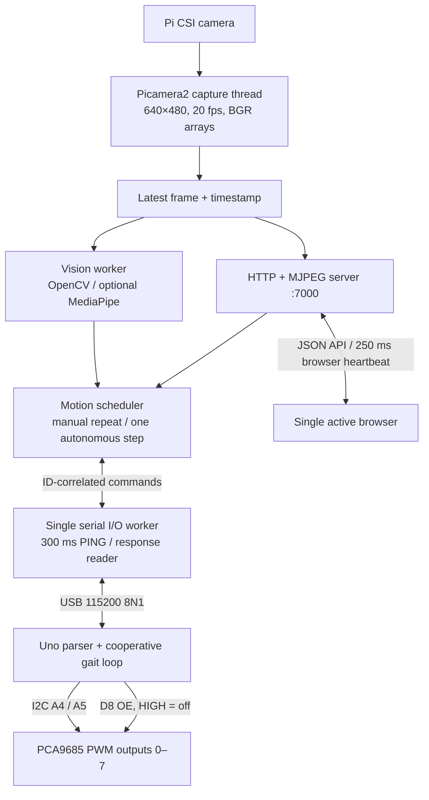
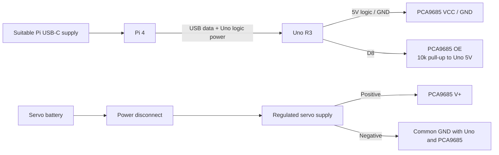

# Pi 4 / Uno R3 Architecture

## Responsibilities

Picamera2 owns the CSI camera in one thread. `RGB888` is BGR byte order on the Pi and is passed directly to OpenCV. Stale frames expire after 0.8 seconds; autonomous control disables servos when the camera is unavailable. Blue-ball and gesture detections require successive fresh frames. Manual control does not require a camera.

The scheduler repeats directional gait steps only in manual mode. Vision requests one step at a time, with a 1.5-second request cooldown, rather than leaving a walking command latched. Changing control modes clears the previous desired direction and requests stand. A request generation prevents an old response from overwriting a newer desired motion.

## Power and Output Enable

The external OE pull-up disables servo signals while Uno pins are inputs during reset / bootloader operation. The sketch asserts D8 HIGH before initializing I2C. ARM drives OE LOW, but all channels remain full-off until an explicit motion or calibration command writes pulses. STOP and the watchdog drive OE HIGH and mark channels full-off.

Disabling pulses removes holding torque; it is not a guaranteed stable standing pose. Support the chassis during initial checks and retain a physical servo supply disconnect. The output-enable circuit is a software-controlled stop, not a certified emergency-stop system.

## Serial Protocol v1

ASCII lines terminated by LF (`\n`), 115200 baud, 8 data bits, no parity, one stop bit. The Uno parser accepts up to 63 characters per line, discards overflowing input through the next newline, uses fixed buffers, and avoids dynamic Arduino `String` allocation.

| Pi → Uno | Uno response |
| --- | --- |
| `HELLO` | `READY Quadruped107 1`; always disarms |
| `PING` | `PONG`; renews the Uno watchdog |
| `ARM 1` | `DONE 1 armed` if the PWM driver is available |
| `MOVE 2 forward` | `ACCEPT 2 forward`, then `DONE 2 forward` or `ERR 2 stopped` |
| `STOP 3` | `DONE 3 stopped`; aborts the active move |
| `SERVO 4 0 278` | `DONE 4 servo`; channel 0, pulse 278 |

The numbers are request IDs. Only `DONE` / `ERR` with the matching ID complete a request; `ACCEPT`, `PONG`, and unrelated responses do not. Supported motion names: `initial`, `stand`, `greeting`, `tail_wag`, `forward`, `backward`, `turn_left`, `turn_right`.

The Pi opens the port exclusively where supported, waits two seconds for the Uno USB reset / bootloader, sends HELLO, and checks the exact firmware identity. It sends PING every 300 ms even while a MOVE is pending. Servo sweeps use cooperative delays that continue to parse PING / STOP. Other moves and ARM are rejected while a gait is active.

## Failure Behavior

| Event | Result |
| --- | --- |
| Application / Uno startup | Disabled; no automatic pose |
| Movement key released | Current step finishes, then stand; STOP interrupts immediately when serviced |
| Browser hides / loses focus / closes | Best-effort STOP; lease is the fallback |
| Browser heartbeat absent for 1 second | Pi requests STOP and clears the desired motion |
| Held direction missing from heartbeat | Pi corrects the desired motion to stand |
| Pi/USB heartbeat absent for 1.5 seconds | Uno disables outputs and emits `FAULT watchdog` |
| Serial reset / disconnect / command timeout | Pending requests fail; no replay; explicit enable required after reconnect |
| Missing / stale camera during vision mode | Disable outputs; manual control can be enabled separately |
| Missing gesture package / model | Gesture mode unavailable; other features remain available |

Only one serial reader owns the port. HTTP handlers never independently read USB responses. An optional systemd service runs the same single-process application; do not launch multiple web workers against the same Uno or camera. The HTTP service is for one operator on a trusted LAN and does not provide authentication.

## Reference Documentation

- [Raspberry Pi camera installation and modern camera software](https://www.raspberrypi.com/documentation/accessories/camera-software.html)
- [Picamera2 installation and OS package guidance](https://github.com/raspberrypi/picamera2)
- [Picamera2 manual, including pixel formats](https://datasheets.raspberrypi.com/camera/picamera2-manual.pdf)
- [Arduino Uno R3 hardware](https://docs.arduino.cc/hardware/uno-rev3/)
- [MediaPipe Tasks Gesture Recognizer for Python](https://ai.google.dev/edge/mediapipe/solutions/vision/gesture_recognizer/python)
